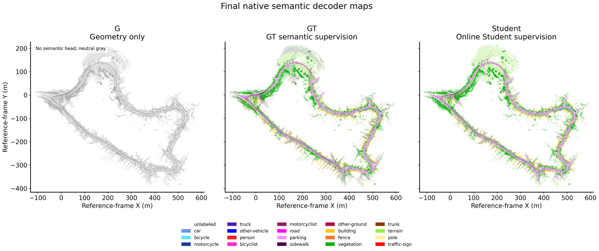

# 毕业论文展示网站：本地预览、修改与 GitHub Pages 发布指南

这是一套可以直接使用的英文论文项目页，采用与 Wheat3DGS 类似的学术展示布局：论文信息、资源按钮、主视觉、摘要、方法、实验、演示和引用。网站由 HTML、CSS 和 JavaScript 组成，不需要安装 Node.js，也没有必须联网加载的外部 CDN。

**现在就可以预览。** 作者、学校、导师、正式标题及下载链接尚未确定的部分已经留出位置；正式公开前，按同目录的 `PLACEHOLDERS_待补清单.md` 逐项填写。

## 1. 先在电脑上看效果

### 最直接的方法：双击首页

1. 如果拿到的是 ZIP，先完整解压。
2. 打开解压后的文件夹，找到 `index.html`。
3. 双击，用 Edge、Chrome 或 Firefox 打开。

请保留 `index.html` 与 `static` 文件夹的相对位置，不要只把首页复制到别处。双击方式可以离线查看页面、图片和布局；部分浏览器对本地文件的剪贴板操作有限制，复制引用若不成功，可手动选中复制，或采用下面的本机预览方式。

### 用本机网页地址预览

双击根目录的 `PREVIEW.bat`。它使用电脑已有的 Python 启动本机预览服务；没有 Python 时，仍可用上面的双击首页方式。

服务启动后，打开：

<http://127.0.0.1:8000/>

使用期间保留命令窗口，结束后在窗口按 `Ctrl+C`。如果 8000 端口已被占用，可在 PowerShell 中改用 8001：

```powershell
python -m http.server 8001 --bind 127.0.0.1 --directory "C:\Users\75264\Documents\master thesis\output\website\DINO_LiDAR_Thesis_20261107"
```

然后打开 <http://127.0.0.1:8001/>。如果电脑使用 Python Launcher，将命令开头的 `python` 换成 `py -3`。若网站移动到别处，也要相应修改 `--directory` 后的路径。

这个命令只启动本机预览；真正对外发布由 GitHub Pages 托管，不需要让自己的电脑一直开机。Python 命令参数说明见 [Python 官方文档](https://docs.python.org/3/library/http.server.html#command-line-interface)。

## 2. 文件分别负责什么

```text
DINO_LiDAR_Thesis_20261107/
├─ index.html                    首页内容、论文信息、结果和引用
├─ .nojekyll                     GitHub Pages 静态网站标记
├─ PREVIEW.bat                   Windows 本机预览入口
├─ README_中文.md                 本指南
├─ PLACEHOLDERS_待补清单.md        正式公开前需要填写的项目
├─ sources/                      模板来源、素材及结果溯源说明
└─ static/
   ├─ css/
   │  ├─ bulma.min.css           页面基础样式
   │  └─ index.css               本站配色、排版和响应式布局
   ├─ js/
   │  └─ index.js                资源链接配置和页面交互
   ├─ images/                   主视觉、方法图、分割、地图、轨迹等
   ├─ pdfs/                     后续存放正式论文、海报等 PDF
   └─ videos/                   后续存放演示视频
```

具体图片以交付目录内的实际文件为准。模板来源和许可说明应随网站保留；修改论文内容时，不需要删除这些说明。

## 3. 如何改成你的正式论文主页

建议用 VS Code 打开整个网站文件夹。没有 VS Code 时，也可以用文本编辑器打开文件；保存时使用 UTF-8 编码，保留原扩展名。

### 3.1 修改首页文字

打开 `index.html`，搜索 `TODO`，先填写正式标题、作者、学校、导师和年份。然后按页面顺序阅读并修改摘要、方法说明、结果图注和引用。

修改文字时，保留文字外面的 HTML 标签。例如只替换标题标签中的文字，不删除 `<h1>` 与 `</h1>`。保存后刷新浏览器即可查看。修改样式后若浏览器仍显示旧效果，可按 `Ctrl+F5` 强制刷新。

网页内容建议保持这个阅读顺序：

1. **标题和一句话概述**：让访客知道论文解决什么问题。
2. **主视觉**：用分割结果、语义地图或组合图直接展示成果。
3. **摘要**：说明问题、方法和主要发现。
4. **方法**：配一张流程图，讲清训练与部署的关系。
5. **结果**：精选量化结果和可视化，每张图附简短解释。
6. **资源与引用**：提供论文、代码、演示及正式引用信息。

页面中的示例组织围绕你的 DINO 指导、LiDAR 部署与 PIN-SLAM 集成主题。正式公开前，请对照最终论文核对文字、实验数字、图注和数据划分；尤其保持 SemanticKITTI 验证序列 08 与测试序列 11–21 的区分。

### 3.2 填写 PDF、Code、Video、Poster 按钮

打开 `static/js/index.js`，在文件顶部找到 `RESOURCE_LINKS`。

- 只修改对应项目右侧的链接值，保留文件现有的键名和引号结构。
- 链接暂未准备好时，保留现有空值；按钮会弹出明确的待补提示。
- 不要为了消除占位而填入别人的论文、模板代码仓库或无关视频。

可以使用站内相对路径或外部完整网址：

```text
论文：./static/pdfs/thesis.pdf
海报：./static/pdfs/poster.pdf
演示：./static/videos/demo.mp4
代码：https://github.com/你的用户名/你的代码仓库
```

本套文件没有假造可下载的最终论文 PDF。准备好正式文件后，将其放进对应目录，再填写链接。也可以把论文按钮指向学校论文库，将视频按钮指向公开视频平台。

例如，准备好对应资源后，可以改为（把示例用户名和仓库名换成自己的；没有准备的项保留 `null`）：

```javascript
const RESOURCE_LINKS = {
  thesis: './static/pdfs/thesis.pdf',
  code: 'https://github.com/YOUR_USERNAME/YOUR_CODE_REPOSITORY',
  video: null,
  poster: null,
};
```

### 3.3 替换图片

打开 `static/images/`，结合首页中的 `` 路径确定要替换的图片。最省事的方法是使用新图片覆盖同名文件；若扩展名或文件名改变，还要同步修改 `index.html` 中对应的 `src` 和外层按钮的 `data-lightbox`。图注、`alt` 和 `data-caption` 也要与新图一致。

建议：

- 方法示意图优先用 SVG，截图和点云渲染可用 JPG、PNG 或 WebP。
- 页面主图保留足够分辨率，普通展示图可控制在约 1600–2400 像素宽。
- 一般图片尽量压缩到数百 KB；需要细节的结果图可以适度增加大小。
- 图中文字在手机上也应能辨认，图注中的序列、方法和指标与图片保持一致。
- 分享预览图与 favicon 也应换成自己的项目元素。

以上是加载与展示建议，并非 GitHub 的上传硬限制。

### 3.4 添加演示视频

短视频可以放在 `static/videos/`，使用常见的 MP4 编码，并在对应视频区域配置路径。若只是提供下载或外部观看入口，填写顶部资源链接即可；若要让视频直接在页面内播放，还需要修改首页的视频展示区域。

较长视频建议放在公开视频平台，再将网页中的链接指向它。网站文件夹不必存放模型权重、完整数据集或训练输出。

在 `index.html` 搜索 `TODO_DEMO_VIDEO`，将下方的占位框替换为如下代码即可嵌入自己的短视频：

```html
<video controls playsinline preload="metadata" style="width:100%"
       poster="./static/images/teaser.jpg">
  <source src="./static/videos/demo.mp4" type="video/mp4">
</video>
```

### 3.5 修改配色与字体大小

修改 `static/css/index.css` 即可。优先调整该文件中的颜色、字体、间距和图片宽度，通常无需修改 `bulma.min.css`。每次调整后同时查看电脑宽屏和手机窄屏效果。

## 4. 在 GitHub 创建自己的网页仓库

这套成品已经包含网页文件，**无需再从其他模板创建一次仓库**。

1. 登录 GitHub，点击右上角 `+` → `New repository`。
2. Owner 选择自己的账号。
3. Repository name 可填 `master-thesis`，也可以使用论文简称。
4. 选择 **Public**。这条指南采用 GitHub Free 的公开仓库发布方式。
5. 不勾选初始化 README、`.gitignore` 或 License，先创建一个空仓库。
6. 点击 `Create repository`。

假设用户名为 `USERNAME`，仓库名为 `master-thesis`：

```text
仓库地址：https://github.com/USERNAME/master-thesis
网页地址：https://USERNAME.github.io/master-thesis/
```

不需要把仓库命名为 `USERNAME.github.io`，也不需要先创建个人主页。论文可以作为独立项目页发布。GitHub Pages 支持情况见 [GitHub 官方创建指南](https://docs.github.com/en/pages/getting-started-with-github-pages/creating-a-github-pages-site)。

## 5. 上传文件：选网站文件夹里面的内容

1. 进入刚创建的空仓库。
2. 点击页面中的 `uploading an existing file`，或使用 `Add file` → `Upload files`。
3. 在电脑上打开网站文件夹，选择里面的 `index.html`、`static`、`sources` 及随附说明文件并拖入上传区域。
4. 等待上传完毕，填写提交说明，例如 `Add thesis project website`。
5. 点击 `Commit changes`，完成首次提交。

**不要将 ZIP 文件当作网站上传。不要再把整个 `DINO_LiDAR_Thesis_20261107` 外层目录套在仓库根目录下面。**

上传完成后，仓库第一层应直接能看到 `index.html` 和 `static`。正确结构为：

```text
master-thesis/index.html
master-thesis/static/css/index.css
```

不是：

```text
master-thesis/DINO_LiDAR_Thesis_20261107/index.html
```

网页上传每次最多支持 100 个文件，单文件不超过 25 MiB；如果增加素材后超过一次上传数量，可以分批上传。[GitHub 官方上传说明](https://docs.github.com/en/repositories/working-with-files/managing-files/adding-a-file-to-a-repository)

### `.nojekyll` 没有一起传上去怎么办

先检查仓库根目录是否已经有 `.nojekyll`。若没有，可以直接在 GitHub 创建：

1. `Add file` → `Create new file`。
2. 文件名输入 `.nojekyll`，注意最前面有一个点，不带 `.txt`。
3. 内容可以写一行 `Static website.`，标记文件的内容不参与网页展示。
4. 提交到 `main`。

这个文件让 GitHub Pages 按静态文件处理本站，跳过默认 Jekyll 构建。参见 [GitHub 官方说明](https://docs.github.com/en/pages/getting-started-with-github-pages/creating-a-github-pages-site)。

## 6. 打开 GitHub Pages

1. 在自己的网页仓库中打开 `Settings`。
2. 左侧菜单选择 `Pages`。
3. 找到 `Build and deployment`。
4. `Source` 选择 **Deploy from a branch**。
5. `Branch` 选择 **main**；如果你的文件实际提交在其他分支，就选择那个分支。
6. 目录选择 **/(root)**。
7. 点击 **Save**。

随后打开仓库的 `Actions`，查看 Pages 工作流是否成功。即使选择了从分支部署，GitHub 也会在后台运行 Pages 工作流。成功后回到 `Settings` → `Pages`，使用 `Visit site` 打开最终网址。[GitHub 官方部署源设置](https://docs.github.com/en/pages/getting-started-with-github-pages/configuring-a-publishing-source-for-your-github-pages-site)

首次部署或后续更新可能需要几分钟；GitHub 官方说明推送后变更可能最多约 10 分钟才显示。[发布时间说明](https://docs.github.com/en/pages/getting-started-with-github-pages/creating-a-github-pages-site)

## 7. 后续如何更新

少量文字修改：在 GitHub 打开 `index.html`，点击编辑按钮，修改后提交。资源按钮同理，编辑 `static/js/index.js` 中的 `RESOURCE_LINKS`。

多处修改或换图：先在电脑上修改并预览，再将改过的文件按原目录上传到同一个仓库，提交替换。无需重新创建仓库，也无需重新配置 Pages。提交到发布分支后，等待新一轮部署完成，再刷新网页。

以后更新图片或视频时，维持路径一致；如果文件改名，同时修改使用它的 HTML 或 JavaScript 链接。

## 8. 路径与容量：最容易出错的几处

### 资源路径

主页中的资源请优先使用 `./static/...` 这样的路径：

```html

```

在 `https://USERNAME.github.io/master-thesis/` 下，`/static/...` 会从域名根目录寻找文件，容易遗漏 `/master-thesis/`。`./static/...` 会从当前项目目录寻找。[相对路径解析说明](https://developer.mozilla.org/en-US/docs/Web/API/URL_API/Resolving_relative_references)

CSS 文件中的 `url(...)` 则相对于 CSS 文件所在位置计算。文件名和扩展名也应保持大小写完全一致，不要把 `Image.PNG` 与 `image.png` 混用。

### 文件大小

- GitHub 浏览器上传的单文件上限为 **25 MiB**；常规 Git 推送会阻止超过 **100 MiB** 的单文件。[GitHub 大文件说明](https://docs.github.com/en/repositories/working-with-files/managing-large-files/about-large-files-on-github)
- 已发布 GitHub Pages 网站大小不能超过 **1 GB**。[GitHub Pages 限制](https://docs.github.com/en/pages/getting-started-with-github-pages/github-pages-limits)
- Git LFS 不能用于 GitHub Pages 网站，因此长视频和大型资源应采用合适的外部托管链接。[Git LFS 官方说明](https://docs.github.com/en/repositories/working-with-files/managing-large-files/about-git-large-file-storage)

## 9. 出现问题时先检查哪里

| 现象 | 优先检查 |
| --- | --- |
| 整个网页 404 | Pages 是否保存；分支和目录是否正确；`index.html` 是否在仓库根目录；Actions 是否成功 |
| 文字正常，图片或样式缺失 | `static` 是否上传完整；相对路径、文件名和大小写是否一致 |
| 首页变成 README 文字 | 检查 `index.html` 是否在所选发布目录的顶层 |
| 修改后看不出变化 | 查看最新部署是否完成，然后按 `Ctrl+F5` 刷新 |
| PDF、Code、Video、Poster 弹出待补提示 | 在 `RESOURCE_LINKS` 填入正式地址，并确认对应文件已上传 |
| 本地预览提示端口占用 | 关闭已有预览窗口，或换用 8001 等端口 |
| 双击模式无法自动复制引用 | 手动复制引用文本，或用本机 HTTP 预览地址打开 |

更多部署排查见 [GitHub Pages 404 官方指南](https://docs.github.com/en/pages/getting-started-with-github-pages/troubleshooting-404-errors-for-github-pages-sites)。

